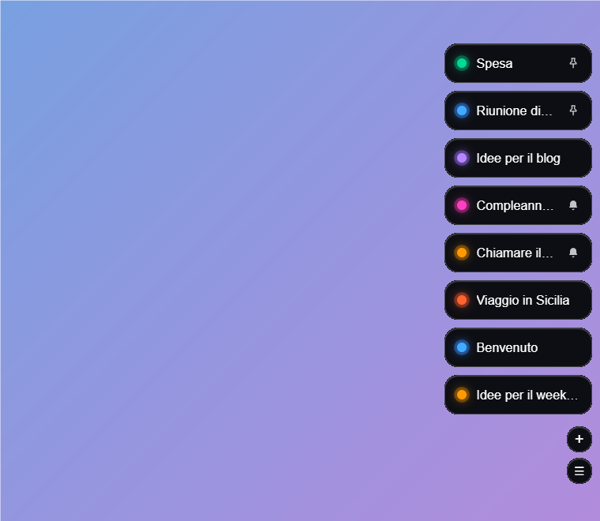
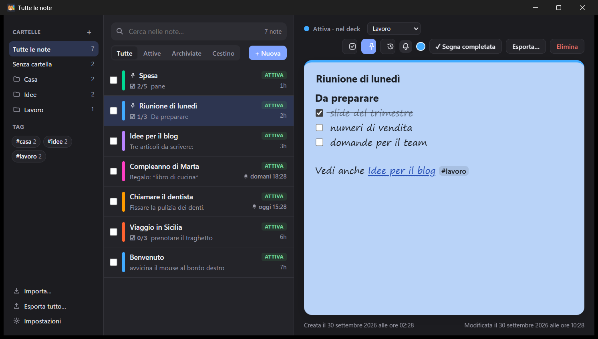

# Tabby

Sticky notes per Windows agganciate al bordo dello schermo. Pillola a riposo, ventaglio di linguette quando il cursore si avvicina, nota a piena dimensione al clic. Il nome viene dalle linguette (*tabs*) del deck… e dal gatto tigrato dell'icona.

Creato da **Roberto Pisco Pisconti**.

Stack: **Tauri 2 (Rust) + SvelteKit (Svelte 5) + SQLite (rusqlite) + CodeMirror 6**.
Il piano è in [`docs/PIANO.md`](docs/PIANO.md); cosa è fatto e cosa resta in [`docs/TODO.md`](docs/TODO.md).





## Scarica

Vai alla pagina delle [**Releases**](https://github.com/RobyPisco/tabby/releases/latest) e scarica `Tabby_*_x64-setup.exe` (oppure l'`.msi`). Serve Windows 10/11. L'installer propone di installare **per tutti gli utenti** (in `C:\Programmi\Tabby`, serve un account amministratore) oppure **solo per te** (in `%LOCALAPPDATA%\Tabby`, senza amministratore). Se aggiorni da una versione precedente installata "solo per te", scegli di nuovo quella modalità, oppure disinstalla prima la vecchia: i dati (note, immagini, impostazioni) non vengono toccati.

L'installer non è ancora firmato: se Windows mostra "App non riconosciuta", scegli *Ulteriori informazioni* → *Esegui comunque*.

## Licenza

[MIT](LICENSE) © 2026 Roberto Pisco Pisconti.

## Cosa fa

- **Deck sul bordo** destro o sinistro, sempre in primo piano e trasparente ai clic a riposo; note fissate in cima; si riposiziona da solo se cambiano monitor, risoluzione o scala.
- **Editor Markdown dal vivo**: caselle da spuntare, titoli, grassetto/corsivo, immagini e allegati incollati o trascinati, link web, link tra note `[[titolo]]` e tag `#parola`; modelli rapidi.
- **Tutte le note**: ricerca full-text (anche senza accenti), filtri, cartelle, tag, selezione multipla, cestino, cronologia delle versioni, "Citata in".
- **Promemoria** con ricorrenza, notifiche di Windows con *10 min / 1 ora / Domani / Fatto / Altro*, date scritte a parole ("domani alle 9"); posticipo a un orario a scelta e ora di "Domani" configurabile.
- **Non disturbare**: per 30 minuti, 1-2 ore, fino a domattina o in una fascia oraria fissa (es. 22-8); i promemoria arrivano tutti insieme alla fine.
- **Timer / pomodoro** su una nota: 25 min di concentrazione, pausa, durata a scelta; il tempo rimasto appare sulla linguetta e alla fine arriva una notifica con "Pausa" / "Altri 25 min".
- **Sincronizzazione tra PC** (facoltativa): scegli la stessa cartella di Google Drive, OneDrive o Dropbox su ogni PC e Tabby tiene le stesse note ovunque, senza server né account. Se una nota cambia su due PC, vince la modifica più recente e l'altra resta nella cronologia.
- **Cifratura** facoltativa della cartella condivisa con una frase segreta; **copie leggibili dal telefono** (un `.md` per nota nella cartella di Drive); **liste condivise** con altre persone (es. la spesa con la famiglia) tramite una cartella cloud condivisa con loro.
- **Cerca ovunque** con `Ctrl+Alt+F`: barra al centro dello schermo, Invio apre la nota.
- **Backup automatico** giornaliero di note, immagini e impostazioni in una cartella a scelta (meglio su un altro disco o in OneDrive), con ripristino dalle impostazioni.
- **Cattura rapida** degli appunti, **export** (Markdown/testo, un file per nota o file unico) e **import**.
- **Impostazioni**: bordo, larghezza, schermo, carattere, colore delle note nuove, suono, tema, avvio con Windows.

## Scorciatoie

| Tasti | Azione |
| --- | --- |
| `Ctrl+Alt+L` | Tutte le note |
| `Ctrl+Alt+N` | Nuova nota nel deck |
| `Ctrl+Alt+P` | Nuova nota con promemoria |
| `Ctrl+Alt+V` | Salva gli appunti come nota |
| `Ctrl+Alt+H` | Mostra/nascondi il deck |
| `Ctrl+Alt+D` | Non disturbare per un'ora / riattiva le notifiche |
| `Ctrl+Alt+F` | Cerca ovunque: barra di ricerca al centro dello schermo, Invio apre la nota |
| `Ctrl+L` / `Ctrl+Invio` | Casella da spuntare / spunta la riga |
| `Ctrl+B` / `Ctrl+I` / `Ctrl+Shift+X` | Grassetto / corsivo / barrato |
| `Ctrl+F`, `Ctrl+N`, `Esc` | Ricerca, nuova nota, chiudi (in "Tutte le note") |

Se un'altra app occupa già una scorciatoia globale, quella viene saltata senza bloccare l'avvio.

Maggiori dettagli nell'[informativa sulla privacy](PRIVACY.md).

## Dati

Tutto resta sul PC, in `%APPDATA%\it.pisco.tabby\` (o nella cartella indicata da `TABBY_DATA_DIR`, utile per le prove): `notes.db` (SQLite), `media\` (immagini e allegati), `settings.json`. Dalle impostazioni c'è "Apri la cartella".

**Backup**: una volta al giorno Tabby copia database, immagini e impostazioni in una cartella `tabby-AAAA-MM-GG_HHMMSS` (di default in `backups\` dentro la cartella dei dati, oppure dove scegli nelle impostazioni) e tiene gli ultimi 7. Le immagini uguali al backup precedente sono collegamenti fisici, quindi non occupano spazio due volte. "Ripristina" sostituisce le note con quelle del backup, dopo aver salvato lo stato attuale in un nuovo backup.

## Sviluppo (Windows 11)

1. **Node.js** 20+ (sviluppato con 24).
2. **Rust** (`rustup`, toolchain `stable-x86_64-pc-windows-msvc`).
3. **Visual Studio Build Tools** con il workload *Sviluppo di applicazioni desktop con C++*.
4. **WebView2** (già presente su Windows 11).

```powershell
git clone https://github.com/RobyPisco/tabby.git
cd tabby
npm install
npm run tauri dev      # sviluppo (la prima build compila parecchi crate, qualche minuto)
npm run check          # controllo TypeScript/Svelte
npm test               # test del frontend (Vitest)
cd src-tauri; cargo test   # test di Rust
npm run tauri build    # installer in src-tauri\target\release\bundle\ (nsis e msi)
```

In sviluppo le notifiche appaiono come "Windows PowerShell": l'app non è registrata in Windows finché non è installata. Versione di sviluppo e versione installata condividono dati e "istanza unica": non vanno tenute aperte insieme.

L'icona (il gatto tigrato) sta in `assets/app-icon.png` e si applica con `npx tauri icon assets/app-icon.png` (l'icona piccola per l'area di notifica è `src-tauri/icons/tray.png`); le immagini dell'installer (da `assets/`) si rigenerano con `scripts\genera-immagini-installer.ps1`.

## Struttura

- `src-tauri/src/` — `db.rs` (note, ricerca, promemoria), `organize.rs` (tag, cartelle, link, versioni), `reminders.rs` (scheduler), `toast.rs`, `dock.rs` (finestra del deck), `capture.rs`, `export.rs`, `media.rs`, `settings.rs`, `tray.rs`, `lib.rs` (comandi e avvio).
- `src/routes/+page.svelte` — il deck; `src/routes/all/+page.svelte` — "Tutte le note".
- `src/lib/` — editor (`NoteEditor.svelte`, `editor/`), componenti condivisi, impostazioni, date a parole.
